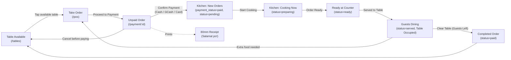

# Servio Frontend — System Analysis & Architecture

## 1. Executive Analysis

Servio is a single-page operational web application built with **Vue 3**, **TypeScript**, **Pinia**, **Vue Router**, **Tailwind CSS v4**, and **`@vuetify/v0`**. It implements all **8 functional modules** required for front-of-house service, back-of-house kitchen preparation, cashiering, and back-office administration under a strict **Pay First, Dine After** operational rule.

### Architectural Highlights
- **100% LAN Offline Capability**: Zero external CDNs. Fonts (`Merriweather`, `Nunito`, `Geist Mono`), SVG icons (`BaseIcon.vue`), brand logos, and all 21 food photographs live inside the Vite bundle or `public/`.
- **Dual-Mode Service Layer (`VITE_USE_MOCK`)**: Every API call flows through `src/services/*` (`api.ts`, `menuService.ts`, `orderService.ts`, `tableService.ts`, `userService.ts`). Toggling `VITE_USE_MOCK=false` switches transparently from in-memory mock data to the Laravel Sanctum REST API without modifying a single component or store.
- **Zero-Reflow Live Sync**: `useOrdersStore` polls every `3.5s` and patches existing order objects in place (`status`, `payment_status`, `total`, `items`), maintaining a verified Cumulative Layout Shift (**CLS**) of **`0.0005`** on cold load + live polling.
- **Strict Separation of Optimistic vs. Financial Actions**: Cart mutations, menu sold-out toggles, and kitchen status progressions update optimistically (with automatic rollback or Undo toast). Order creation for billing and **payment settlement are never optimistic** — submit buttons disable and wait for explicit server confirmation.

---

## 2. Functional Module Coverage (8 Modules → Codebase Map)

| # | Module | Primary Views | Stores & Services | Key Operational Rules |
| :- | :--- | :--- | :--- | :--- |
| **1** | **Authentication & RBAC** | `LoginView.vue` | `stores/auth.ts`, `router/index.ts`, `services/api.ts` | Sanctum Bearer tokens, active-account check (`is_active`), mandatory first-login password change (`must_change_password`), automatic role-based landing redirect. |
| **2** | **Staff & User Management** | `UsersView.vue` | `services/userService.ts` | Register employees (`admin`, `waiter`, `kitchen`), reset temporary passwords, soft activate/deactivate via `BaseSwitch` so historical order attribution (`user_id`) is preserved. |
| **3** | **Table & Floor Management** | `TablesView.vue` | `stores/tables.ts`, `services/tableService.ts` | Full-page visual dining room (`Table 1`–`Table 10`, 2/4/6/8-seat diagrams) showing **Available**, **Unpaid**, **Occupied**, and **Food Ready** states. Locks table on order and releases only on **Clear Table** or unpaid cancel. |
| **4** | **Menu & Catalog Management** | `MenuManagementView.vue` | `stores/menu.ts`, `services/menuService.ts` | Dish CRUD with **click / drag-and-drop photo upload** (JPG/PNG/WebP ≤ 5 MB, 4:3 preview, Data URL in mock mode, `FormData` in live mode) + optimistic **Sold Out** switch synced to waiter screens. |
| **5** | **POS & Order Management** | `PosView.vue`, `ActiveOrdersView.vue` | `stores/cart.ts`, `stores/orders.ts`, `services/orderService.ts` | One-tap dish add (zero detail popups), quantity steppers, progressive kitchen notes, optimistic **Clear list** with **Undo toast**, extra-food orders, and cancellation with mandatory reason (`CancelOrderModal.vue`). |
| **6** | **Kitchen Display System (KDS)** | `KitchenView.vue` | `stores/orders.ts`, `composables/useTicker.ts` | Full-screen dark high-contrast board (no sidebar). **Only displays paid orders** (`payment_status === 'paid'`). Shared 1-second timer highlights tickets overdue past 10 minutes. |
| **7** | **Billing, Payment & Receipts** | `PaymentView.vue`, `ReceiptView.vue` | `stores/orders.ts`, `services/orderService.ts` | Enforces **Pay First, Dine After**. Supports Cash (quick denomination pills + change math), GCash, and Card (exact-amount check). Prints 80 mm thermal receipts (`72mm` / `42ch` Geist Mono). |
| **8** | **Dashboard & Sales Reporting** | `DashboardView.vue` | `stores/orders.ts`, `stores/tables.ts` | Live sales KPIs (Today's Sales, Paid Orders, Occupied Tables, Average Bill), `Asia/Manila` date-range filter, payment-method split, top-selling dishes with progressive disclosure, and live floor monitor. |

---

## 3. Role-Based Access Control (RBAC) Matrix

Enforced in [src/router/index.ts](file:///c:/Users/BESAÑEZ_IAS2/Desktop/Servio/frontend/src/router/index.ts) (`router.beforeEach`) and mirrored in [src/components/AppShell.vue](file:///c:/Users/BESAÑEZ_IAS2/Desktop/Servio/frontend/src/components/AppShell.vue):

| Route | View Component | Admin | Waiter | Kitchen | Chrome / Shell |
| :--- | :--- | :---: | :---: | :---: | :--- |
| `/login` | `LoginView.vue` | Guest only | Guest only | Guest only | Full screen |
| `/tables` | `TablesView.vue` | Access | **Default landing** | Blocked | Adaptive sidebar / bottom bar |
| `/pos` | `PosView.vue` | Access | Access | Blocked | Adaptive sidebar / bottom bar |
| `/payment/:id?` | `PaymentView.vue` | Access | Access | Blocked | Adaptive sidebar / bottom bar |
| `/orders` | `ActiveOrdersView.vue` | Access | Access | Blocked | Adaptive sidebar / bottom bar |
| `/kitchen` | `KitchenView.vue` | Access | Blocked | **Default landing** | Full screen (no sidebar) |
| `/admin/dashboard` | `DashboardView.vue` | **Default landing** | Blocked | Blocked | Adaptive sidebar / bottom bar |
| `/admin/menu` | `MenuManagementView.vue` | Access | Blocked | Blocked | Adaptive sidebar / bottom bar |
| `/admin/users` | `UsersView.vue` | Access | Blocked | Blocked | Adaptive sidebar / bottom bar |
| `/admin/reports` | `DashboardView.vue` | Access (expanded) | Blocked | Blocked | Adaptive sidebar / bottom bar |

---

## 4. Pay-First, Dine-After Order Lifecycle

### Key State Invariants
- **Kitchen gate**: `kdsPendingOrders`, `kdsPreparingOrders`, and `kdsReadyOrders` strictly require `payment_status === 'paid'`. Unpaid drafts never leak onto the kitchen display.
- **Table lock duration**: Payment releases the order to the kitchen while keeping the dining table **Occupied**. The table returns to **Available** only when a waiter taps **Clear Table (Guests Left)** (or cancels an unpaid order with no other active paid tickets on that table).
- **Extra food orders**: Ordering additional dishes for an occupied dining table creates a separate unpaid order for just the extra items, sends the waiter to `/payment/:id` to collect payment for the add-on, prints a receipt for the extra items, and sends only the new dishes to the kitchen so already-served mains are never double-cooked.

---

## 5. Component & State Architecture

### Local `@vuetify/v0` Wrapper Layer (`src/components/base/`)
All UI primitives wrap headless `@vuetify/v0` components/composables so application views never couple directly to third-party markup:

| Local Component | `@vuetify/v0` Primitive Used | Responsibility |
| :--- | :--- | :--- |
| `BaseButton.vue` | `Button.Root` | Tactile pill/input buttons, 44/48px touch targets, loading grace `0`, optical icon nudges |
| `BaseCombobox.vue` | `useClickOutside`, `toHighlight`, `useId` | Accessible ARIA 1.2 combobox (keyboard `↑`/`↓`/`Enter`/`Esc`, match highlighting, origin-aware dropdown) |
| `BaseDialog.vue` | `Dialog.Root`, `Dialog.Content`, `Dialog.Title`, `Dialog.Description`, `Dialog.Close` | Centered modal dialog with `inert` when closed, Esc dismiss, interruptible CSS transitions |
| `BaseSheet.vue` | `Dialog.Root`, `Dialog.Content`, `Dialog.Title`, `Dialog.Close` | Mobile bottom order sheet (`safe-pb`) & slide-over panels |
| `BaseSwitch.vue` | `Switch.Root` | Accessible `role="switch"` toggle for Menu Sold-Out & Staff Active states |
| `BaseToast.vue` | `Alert.Root` | Global notification stack supporting polite/assertive ARIA live announcements and **Undo** actions |

### Shared Global 1-Second Ticker (`src/composables/useTicker.ts`)
Rather than creating one `setInterval` per ticket card, `useTicker()` maintains a single reference-counted 1-second reactive clock (`now`) shared across every `OrderCard` and `TableStatusStrip`, preventing timer drift and unnecessary reactivity churn.

---

## 6. Codebase Analysis & Backend Integration Checklist

### Verified Quality Benchmarks
- **Type Safety**: `npm run type-check` (`vue-tsc --build --force`) passes with **0 errors**.
- **Production Bundle**: `npm run build` compiles 571 modules cleanly in `< 1s` with all font assets bundled locally.
- **Browser Audits (Headless Chrome at `360px`, `768px`, `1280px`)**:
  - `0` console errors, `0` runtime exceptions, `0` horizontal overflow, `0` undersized (`< 44px`) touch targets.
  - `21/21` menu dish photos verified loaded (`0` broken).
  - POS cold-load + 3.5s polling **CLS = `0.0005`**.
  - Verified `prefers-reduced-motion: reduce` disables movement and stagger delays.

### Recommended Housekeeping Before Production LAN Cutover
1. **Unused scaffolded devDependencies**: `unocss` and `unplugin-fonts` remain in `package.json` from the original Vuetify CLI scaffold and are no longer imported (`vite.config.mts` uses `@tailwindcss/vite` and direct `@fontsource/*` CSS imports). They can safely be uninstalled later if desired.
2. **Laravel Backend Alignment**: Ensure the Laravel `orders` table/API supports `payment_status` (`unpaid` | `paid`) independently of kitchen `status` (`pending` | `preparing` | `ready` | `served` | `paid` | `cancelled`), and configure `storage:link` + CORS for `POST /api/menu-items` multipart image uploads (details in [API_CONTRACT.md](API_CONTRACT.md)).
3. **Production Deployment on LAN**: Build `dist/` with `VITE_USE_MOCK=false` and serve via Nginx/Apache on the restaurant LAN server (with SPA fallback `try_files $uri $uri/ /index.html;`) so tablets on Wi-Fi access Servio directly by local IP (e.g., `http://192.168.1.100`).
